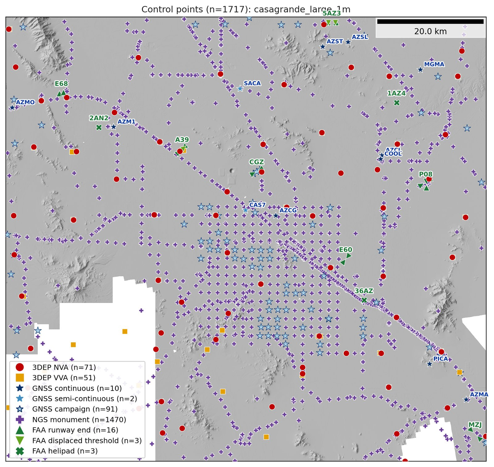
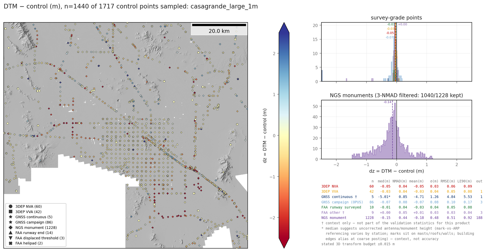

# groundcontrol

[](https://github.com/uw-cryo/groundcontrol/actions/workflows/ci.yml)
[](https://doi.org/10.5281/zenodo.21846300)

Fetch ground control points for an arbitrary AOI and assess DEM accuracy, with rigorous
3D CRS / datum / epoch handling. Given a DEM, groundcontrol samples the control, runs the
accuracy assessment, and produces the analysis and visualization.

<p align="center">
  <a href="docs/img/casagrande_control_map.jpg"></a>
  <a href="docs/img/casagrande_validation_dz_DTM.png"></a>
</p>

*Casa Grande, AZ: control from five sources over the 3DEP hillshade (left) and the DTM
validation figure with per-segment statistics (right).
Click either image for full resolution.*

## Install

Install from a git tag and pin it. The schema is not frozen yet, so column names can
still change between minor versions.

```bash
pip install git+https://github.com/uw-cryo/groundcontrol.git@v0.4.1
```

> ⚠️ `pip install groundcontrol` installs an **unrelated, abandoned** PyPI package, not
> this library. Use the git URL. A conda-forge package is the planned channel; see
> [install notes](docs/quickstart.md) for `--no-deps` installs and the `pyarrow` trap.

## Quick start

**Assess your own DEM.** The DEM is the only required input. The AOI defaults to the
DEM footprint, the control is fetched for you, and the results land in
`dem_groundcontrol/` next to it.

```bash
groundcontrol-assess dem.tif
```

That works when the DEM's embedded CRS declares what its heights are (a compound or 3D
CRS). Most DEMs carry only a 2D CRS, and then the command stops and asks you to state the
vertical datum with `--vdatum`, because an assumed one shows up as a geoid-sized bias of
tens of meters:

```bash
groundcontrol-assess dem.tif --vdatum EPSG:5703            # NAVD88 heights
groundcontrol-assess dem.tif --vdatum ellipsoid:itrf2014   # ellipsoidal heights, realization named
groundcontrol-assess dem.tif --vdatum cop30                # a product preset
```

See the [vertical datum field guide](docs/vdatum.md) for what common products are on.

**Fetch control for an AOI.** A bbox, a vector file, or a raster footprint.

```bash
groundcontrol-fetch --aoi=-115.3,36.0,-114.9,36.3 --out control.parquet
groundcontrol-fetch --aoi site.geojson --sources ngs,opus --out control.parquet
```

**From Python.**

```python
from groundcontrol.sources import fetch_control
from groundcontrol.assess import assess_products
from groundcontrol import io

control, status = fetch_control("dsm.tif", sources=("3dep", "ngs", "opus", "faa"))
io.write(control, "control.parquet", status=status)
sampled, stats, artifacts = assess_products(
    control, {"DSM": "dsm.tif"}, target_crs=open("dsm_frame.wkt").read(),
    outdir="out", site_name="mysite")
```

Every option, AOI form and output file is described in the [CLI reference](docs/cli.md).
The downstream-consumer pattern is in the [quickstart](docs/quickstart.md).

## What you get

Everything lands in one directory, prefixed by the site name.

| File | Contents |
|------|----------|
| `<site>_control.parquet` | the fetched control in one normalized schema, with per-source status and provenance |
| `<site>_assessed.parquet` | control landed in the DEM frame, with sampled heights and `dz` (DEM minus control) per product |
| `<site>_dz_stats.csv` | one row per product and control segment: robust median and NMAD, plus mean, standard deviation, RMSE, LE90, LE95 |
| `<site>_validation_dz_<NAME>.png` | the dz map over a hillshade with histograms, per product |
| review sheets | the largest and smallest residuals as imagery, intensity and relief windows, to tell a bad control point from a DEM error |

What these look like on a real site: [gallery](docs/gallery.md).

## Control sources

| Source | Key | What it is | Coverage | Approx size (Oct 2026) |
|--------|-----|------------|----------|----------------|
| [USGS 3DEP survey checkpoints](https://www.sciencebase.gov/catalog/item/67075e6bd34e969edc59c3e7) | `3dep` | Independent survey checkpoints collected to assess 3DEP lidar projects, 2004-2025: non-vegetated (NVA) and vegetated (VVA) vertical accuracy points with NAVD88 heights and survey dates | US: 50 states, DC, Puerto Rico | 145,000 points from 550 projects (77k NVA, 55k VVA) |
| [NGS datasheets](https://geodesy.noaa.gov/datasheets/) | `ngs` | NGS datasheet survey marks (benchmarks, triangulation and GPS-observed marks) with published horizontal and vertical datums, network accuracies and last-recovered date | US: 50 states, DC, territories | 797,000 marks in the NGS datasheet database; 445,000 with adjusted orthometric heights, 305,000 with adjusted horizontal positions |
| [OPUS shared solutions](https://geodesy.noaa.gov/OPUS/view.jsp) | `opus` | Static GNSS occupations that surveyors submitted to NGS OPUS and chose to share, with reference frame, observation epoch and a monument-stability rating | US: 50 states, DC, territories | 52,800 marks (83,600 solutions) |
| [Nevada Geodetic Laboratory](https://geodesy.unr.edu/) | `ngl` | Daily GNSS position time series for continuous and campaign stations from public archives, with MIDAS velocities and a catalog of equipment and earthquake steps | Global | 23,800 stations (8,100 in the US; 14,300 with data since 2025), MIDAS velocities for 20,000 |
| [FAA National Airspace System Resources (NASR)](https://www.faa.gov/air_traffic/flight_info/aeronav/aero_data/NASR_Subscription/) | `faa` | Runway ends, displaced thresholds and helipads from the FAA 28-day airport database, each with its position source; surveyed points meet AC 150/5300-18C (±1 ft horizontal, ±0.25 ft vertical at 95%) | US: 50 states, DC, territories | 25,300 points at civil facilities, 10,600 of them surveyed |

Details per source are in the [capabilities page](docs/features.md).

## Design principles

- **Fail-loud.** No silent datum guesses, no ballpark transforms, no fabricated epoch
  motion. When geodetic information is missing or ambiguous, the library raises and
  names the fix.
- **One definition of "same frame".** `compare_frames` compares horizontal datum,
  vertical datum, WGS 84 ensemble against realization, and coordinate epoch, so a
  datum-label difference is refused by name instead of becoming a co-registration
  "offset".
- **Epochs are real.** Control in a dynamic frame is propagated to the DEM epoch with
  station velocities or a plate-motion model, never across an earthquake step, and never
  inside a plate-fixed frame.
- **Standards vocabulary.** Statistics follow ASPRS Positional Accuracy Standards Ed. 2
  and the USGS Lidar Base Specification ([conventions](docs/accuracy_conventions.md)).

## Status

**v0.4.1, pre-alpha.** The fetch, transform, sample, statistics and figures pipeline
works end to end from the CLI and from Python. It is covered by 864 offline tests on
Python 3.10 and 3.12, and the geodesy core is adversarially audited with math checked
against external oracles. The API may still move between minor versions; pin the tag.

Not yet implemented: horizontal accuracy measurement (the assessment samples DEM heights
only), fetch-side landing in a target frame (landing happens in the assess step), a `user_points` source for your own checkpoint tables, accumulated per-point
transform budgets, velocity-uncertainty propagation, and ICESat-2 as a dense control
source. Details in the [capabilities page](docs/features.md#not-yet-implemented).

## Documentation

- [CLI reference](docs/cli.md): every option, AOI form, product flag and output file
- [Capabilities](docs/features.md): what each module does, in detail
- [Quickstart](docs/quickstart.md): consuming groundcontrol from another project
- [Gallery](docs/gallery.md): standard outputs on a real site
- [Vertical datum field guide](docs/vdatum.md): what common products are really on
- [Accuracy conventions](docs/accuracy_conventions.md): statistics and reporting
- [CRS implementation](docs/crs_implementation.md): the geodesy directives and their verification
- [Design plan](docs/plan.md) and [control sources survey](docs/control_sources_survey.md)

## Development

```bash
pip install -e ".[dev]"
pytest -m "not network"   # offline suite; drop the marker to include live-API tests
ruff check .              # lint, line-length 100
```

Package layout:

```
src/groundcontrol/
  schema.py        canonical control-point GeoDataFrame contract
  crs.py           CRS/datum/epoch transforms, landing, epoch propagation, frame comparison
  geodesy.py       CRS construction, epoch-pinned pipelines, vertical preflight
  velocity.py      MIDAS velocity interpolation / fill
  aoi.py           AOI contract: bbox / vector file / raster footprint / GeoDataFrame
  networks.py      curated reference-network membership registry (ngs_cors, igs)
  assess.py        transform -> sample -> stats assessment pipeline
  sample.py        raster sampling (windowed / in-memory / radius)
  accuracy.py      dual-track residual statistics (robust + ASPRS/LBS parametric)
  io.py            GeoParquet/CSV export + transform provenance
  figures.py       standard per-site control + validation figure bundles, contact sheets
  plot.py          map/velocity/hillshade plotting primitives
  cli.py           console entry points (groundcontrol-fetch, groundcontrol-assess)
  sources/         3dep, ngs/opus, ngl, faa providers + fetch_control dispatcher
  data/            bundled ITRF2020 PMM poles + PB2002 plate boundaries (ODC-By 1.0)
```

## Citation

Archived on Zenodo. The concept DOI below always resolves to the latest release, and each
release also gets its own version DOI. Machine-readable metadata lives in
[`CITATION.cff`](CITATION.cff) (GitHub's *Cite this repository* button reads it).

> Shean, D. (2026). *groundcontrol* (v0.4.1). Zenodo. https://doi.org/10.5281/zenodo.21846300

## Origin

Core functionality extracted and generalized from prior UW-cryo project code, 2026.
Datum/epoch recipes follow
[uw-cryo/3D_CRS_Transformation_Resources](https://github.com/uw-cryo/3D_CRS_Transformation_Resources).
Bundled plate-boundary data: Bird (2003) PB2002 via
[fraxen/tectonicplates](https://github.com/fraxen/tectonicplates) (ODC-By 1.0); plate poles:
Altamimi et al. (2023) ITRF2020 PMM.
